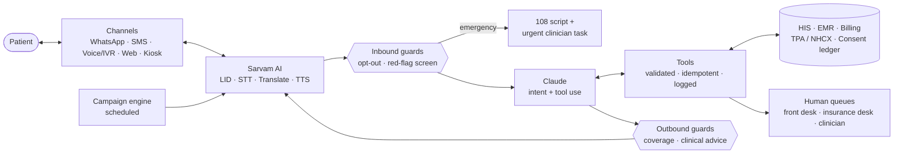

# Healthcare Agent

**A conversational agent for Indian hospitals: patient intake and scheduling, proactive engagement, and
cashless insurance workflows, in the patient's own language, over WhatsApp, SMS, voice and web.**

Claude handles reasoning and tool orchestration. [Sarvam AI](https://www.sarvam.ai) handles Indian-language
speech and text. Every action that changes a record, and every safety decision, goes through
deterministic code rather than the model.

> **Status:** prototype. The conversation loop, tools, guardrails, campaigns and metrics are implemented
> and covered by offline tests. Hospital systems (HIS/EMR, billing, TPA/NHCX) are simulated by an
> in-memory store with the interface real adapters will implement. See [Project status](#project-status).

---

## Why

Indian hospital front offices run on the telephone, paper and a queue. Bookings are phone-only, released
slots go unfilled, nobody follows up after discharge, and pre-authorisations are chased by hand while
discharges wait. This agent does that work through to the end, and it is designed around one principle
from the product brief:

> **The value is not the chat, it is the write-back.** An agent that talks well but cannot create the
> appointment, attach the pre-auth document, or record consent against the right patient has added a
> channel without removing any work.

## What it does

### 1. Patient intake and scheduling
- Booking, rescheduling and cancellation against live consultant availability
- Read-back confirmation before anything is written (*"Thu 29 Oct, 5:00 PM with Dr. Shah. Reply YES"*)
- A **waitlist** where a released slot is offered automatically to the next patient and held for 2 hours
- New-patient registration with an itemised DPDP data notice. ABHA is optional and never required for care
- **Document intake**: prescriptions and reports are extracted, each field is read back, and only what the patient
  confirms is saved, queued for clinician review
- Reminders at **T-24h** (with clinician-approved preparation instructions) and **T-2h**

### 2. Proactive engagement
Three motions, kept deliberately separate:

| Motion | Examples | Consent |
|---|---|---|
| **Care reminders** | appointment reminders, lab-due and refill nudges from the care plan | care communication |
| **Post-visit follow-up** | structured check-in 1–2 days after a visit; red-flag answers escalate to a clinician | care communication |
| **Re-engagement** | recall for lapsed chronic patients, health-check packages | **separate marketing opt-in**, DND respected, `STOP` honoured instantly |

### 3. Insurance workflows
- **Indicative** cashless eligibility: policy validity, network status, waiting periods, sub-limits,
  room-rent cap (with proportionate-deduction warning), co-pay, exclusions
- Pre-authorisation pack assembly, missing-document requests, and answers to TPA queries
- Submission through a **human-in-the-loop insurance desk** (TPA portal / NHCX)
- Tracking of the **IRDAI clocks**: 1 hour for cashless decisions, 3 hours for final discharge authorisation,
  with escalation at 75% of the limit and breach logging
- Simultaneous status updates to ward, billing and patient
- Pre-submission claim documentation QA, with gaps logged so they stop recurring

**The agent never approves anything.** It verifies, assembles, submits, chases and informs. Only the insurer
decides.

## Languages and voice: Sarvam AI

| Capability | Sarvam model |
|---|---|
| Language identification | `text-lid` |
| Indic ↔ English translation | `mayura:v1` (code-mixed in, `modern-colloquial` out) |
| Speech-to-text (voice / IVR) | `saaras:v3` |
| Text-to-speech replies | `bulbul:v3` |

In **pivot mode** (the default), Claude reasons in English and Sarvam translates in both directions. The
safety guards therefore always inspect English, so one rule set covers Hindi, Hinglish, Tamil, Bengali,
Telugu, Marathi and the other supported languages. The emergency screen runs on **both** the patient's
original words and the translation.

## Architecture



### Per-message pipeline
1. **Voice only:** Sarvam speech-to-text
2. Sarvam language ID, then translation to English
3. **Deterministic pre-checks**: `STOP` and opt-out, then the multilingual red-flag screen. An emergency skips the model entirely
4. **Claude turn**: understands intent and calls tools
5. **Deterministic outbound check**: blocks coverage over-statements and clinical advice
6. Sarvam translation into the patient's language, plus Sarvam TTS on voice

## Safety by design

| Rule | How it's enforced |
|---|---|
| **Confirm before commit** | Writes are `propose_*` → read-back → `commit_action`. Code verifies the read-back was shown in an earlier turn **and** the patient's next message is an unqualified yes (`yes`, `haan ji`, `ஆமாம்`…). Idempotency keys prevent double-booking. |
| **Retrieve, never recall** | Clinical and prep facts come only from clinician-approved content. If none exists, the agent hands off. Dosing and diagnostic language is blocked on the way out. |
| **Escalate on red flags** | Chest pain, breathlessness, bleeding, fits, stroke signs, self-harm and paediatric emergencies stop the conversation. The agent sends the 108 / Tele-MANAS script and creates an urgent clinician task, with no triage. |
| **Human handoff is a feature** | Triggers include failed verification, a request for a person, commitments the agent can't make, model refusal, and API errors. Each goes to a named queue with a summary. |
| **No coverage over-statement** | "Approved", "covered" and "nothing to pay" can't reach a patient unless an insurer decision with a written reference exists. Every coverage statement is audit-logged. |

## Regulatory alignment (India)

- **IRDAI Master Circular on Health Insurance (May 2024):** 1h / 3h cashless clocks tracked and escalated
- **DPDP Act 2023 and DPDP Rules 2025:** itemised notice, purpose-scoped consent ledger, one-step withdrawal, audit log
- **ABDM:** ABHA capture is consent-driven and never a precondition for care
- **Telemedicine Practice Guidelines 2020:** the agent informs, reminds and routes. It does not diagnose, dose or triage
- **TRAI DND:** promotional messages are labelled, opt-in only, suppressed on DND for SMS and voice

> This is engineering alignment, not legal advice. Have counsel review the consent architecture before launch.

## Quick start

```bash
git clone https://github.com/mananv26/healthcare-agent.git
cd healthcare-agent
pip install -r requirements.txt

export ANTHROPIC_API_KEY=...   # or: ant auth login
export SARVAM_API_KEY=...      # from dashboard.sarvam.ai

python cli.py                  # chat as a seeded patient (Ravi Kumar, DOB 1979-04-12)
```

| Command | What it does |
|---|---|
| `python cli.py --phone +919845044444` | chat as a Tamil-speaking, voice-first patient (DOB 1958-02-17) |
| `python cli.py --voice sample.wav` | one voice turn: Sarvam STT → agent → Sarvam TTS (writes `reply.wav`) |
| `python cli.py --campaigns` | show what the proactive engine would send right now |
| `python cli.py --no-sarvam` | Claude only, without the Sarvam layer |

Inside the chat: `/tick 60` advances the clock and runs campaigns; `/tasks`, `/outbox`, `/audit` and
`/metrics` show the system state.

### Seeded demo data
| Patient | Phone | DOB | Scenario |
|---|---|---|---|
| Ravi Kumar | +919845011111 | 1979-04-12 | Hindi; diabetic; knee-arthroscopy pre-auth with an open TPA query; HbA1c due |
| Priya Nair | +919845022222 | 1991-11-03 | on the endocrinology waitlist; DND on SMS |
| Arjun Mehta (minor) | +919845033333 | 2018-06-20 | paediatric visit 2 days ago; follow-up due; guardian Neha |
| Lakshmi Subramanian | +919845044444 | 1958-02-17 | Tamil, voice-first; lapsed diabetic with marketing opt-in |

## Deploy (public demo URL)

The repo includes a web server (`server.py`, FastAPI) with a chat page, voice button, staff-queue,
outbox and metrics panels, plus a [Render](https://render.com) blueprint (`render.yaml`).

1. Sign in at [render.com](https://render.com) with GitHub.
2. Choose **New → Blueprint** and pick this repository.
3. Fill in the secrets Render asks for: `ANTHROPIC_API_KEY`, `SARVAM_API_KEY` and `DEMO_ACCESS_CODE` (a
   passphrase you share with testers, so strangers can't spend your API credits).
4. Click **Apply**. A few minutes later the demo is live at `https://healthcare-agent-XXXX.onrender.com`.

Every push to `main` redeploys automatically. Run it locally with `uvicorn server:app --reload` and open
http://localhost:8000.

> The deployment uses **seeded demo data in memory**. It resets on every restart, and on the free plan the
> service sleeps when idle, so the first request takes about 30s. Never enter real patient data: handling
> real data needs a database, encryption, access control and DPDP-compliant hosting in India.

## Configuration

| Setting | Default | Notes |
|---|---|---|
| `HEALTHCARE_AGENT_MODEL` | `claude-opus-5-5` | adaptive thinking, `medium` effort, server-side refusal fallback enabled |
| `SarvamConfig.pivot` | `True` | Claude in English and Sarvam translates. Set `False` for native replies (guards still run on a back-translation) |
| `SarvamConfig.translate_model` | `mayura:v1` | or `sarvam-translate:v1` |
| `SarvamConfig.outbound_mode` | `modern-colloquial` | `formal` · `classic-colloquial` · `code-mixed` |
| `SarvamConfig.stt_model` / `tts_model` | `saaras:v3` / `bulbul:v3` | |
| `SarvamConfig.tts_speaker` / `tts_pace` | model default / `0.9` | slightly slower for older callers |

## Project structure

```
agent/
  agent.py          orchestrator: Session, per-turn pipeline, voice entry point
  sarvam_layer.py   Sarvam AI: language ID, translation, STT, TTS (degrades gracefully)
  guards.py         red-flag screen, explicit-yes gate, opt-out, outbound guard
  tools.py          23 tools; writes use propose → read-back → commit
  campaigns.py      reminders, follow-ups, care-plan nudges, recall, IRDAI clock watcher
  store.py          in-memory HIS / EMR / billing / TPA / consent ledger (replace with adapters)
  metrics.py        brief's KPIs computed from the event log
  prompts.py        system prompt
cli.py              interactive terminal demo
server.py           web server for the hosted demo (FastAPI)
static/index.html   demo chat page
render.yaml         Render deployment blueprint
docs/
  conversation_model.md   full conversation design: states, intents, flows, sample dialogues
tests/              offline tests with scripted Claude and Sarvam fakes
```

## Tests

```bash
python -m pytest -q tests
```

The tests run fully offline, with no API keys. They cover the guardrails, the confirm-before-commit gate
and idempotency, Tamil/Hindi flows through the Sarvam layer, voice turns, waitlist refill, campaign
consent separation, follow-up escalation, coverage checks, pre-auth clocks and API-failure handoff.

## Metrics

`agent/metrics.py` computes the KPIs from the product brief:

- **Intake:** digital intake completion, no-show rate, released-slot refill rate
- **Engagement:** follow-up contact achieved, recall response rate, opt-outs
- **Insurance:** median pre-auth turnaround, discharges authorised within 3h, IRDAI breaches, first-pass claim acceptance
- **Overall:** containment (resolved without a human), red-flag escalations, guard blocks

Baseline them in the first fortnight, and pick **one** as the north star for the deployment.

## Project status

| Component | Status |
|---|---|
| Conversation loop, tools, guardrails, campaigns, metrics | ✅ implemented and tested |
| Sarvam LID / translation / STT / TTS | ✅ implemented against the `sarvamai` SDK. ⏳ live validation pending |
| HIS / EMR / billing adapters | 🔲 simulated (`store.py`). The real write path is the first integration to build |
| TPA / NHCX | 🔲 human-in-the-loop desk for now. NHCX integration planned |
| WhatsApp Business / IVR | 🔲 messaging gateway is simulated (`store.outbox`) |
| Persistence, PII vault, encryption | 🔲 required before any real patient data |

## Roadmap

Sequenced by integration risk, per the product brief:

- **Phase 0 (weeks 0–6):** one specialty, one or two payers, one channel. Confirm the HIS write path and instrument the baseline
- **Phase 1 (weeks 6–16):** intake, scheduling and reminders with heavy human handoff and a small cohort
- **Phase 2 (months 4–7):** follow-ups, care reminders, first consented recall campaign, eligibility checks and pre-auth tracking
- **Phase 3 (months 7–12):** NHCX integration, claim QA, multi-site rollout, language expansion

## Contributing

1. Keep the line between model and code: the model may *propose*, but anything that writes to a system of
   record or makes a safety decision belongs in `tools.py` or `guards.py`.
2. New patient-facing clinical content goes into the approved content library with an approver and
   version, not into prompts.
3. Add a test for every new tool and guard. Run `python -m pytest -q tests` before opening a PR.

## License

Proprietary. All rights reserved. (Replace this section if you intend to open-source the project.)
